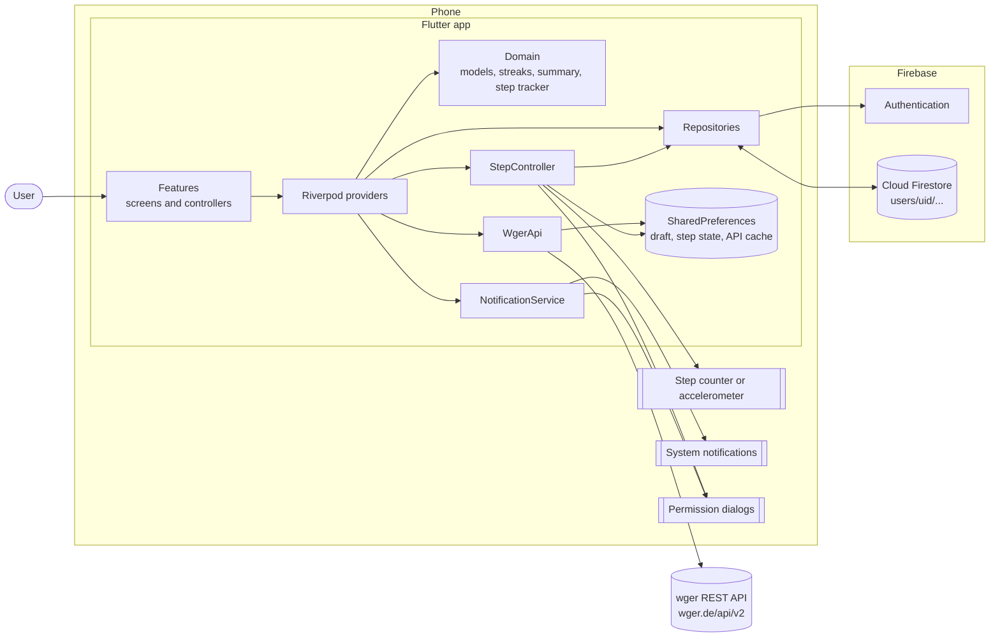
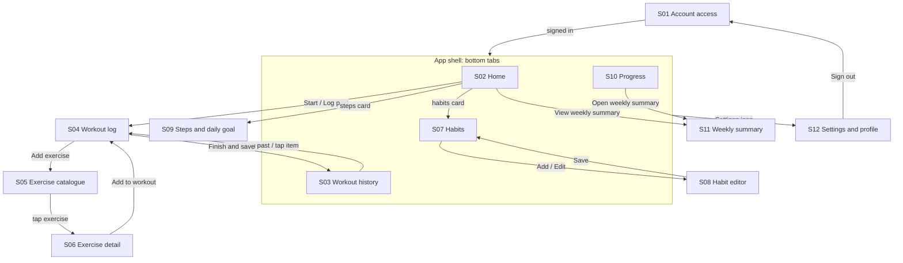
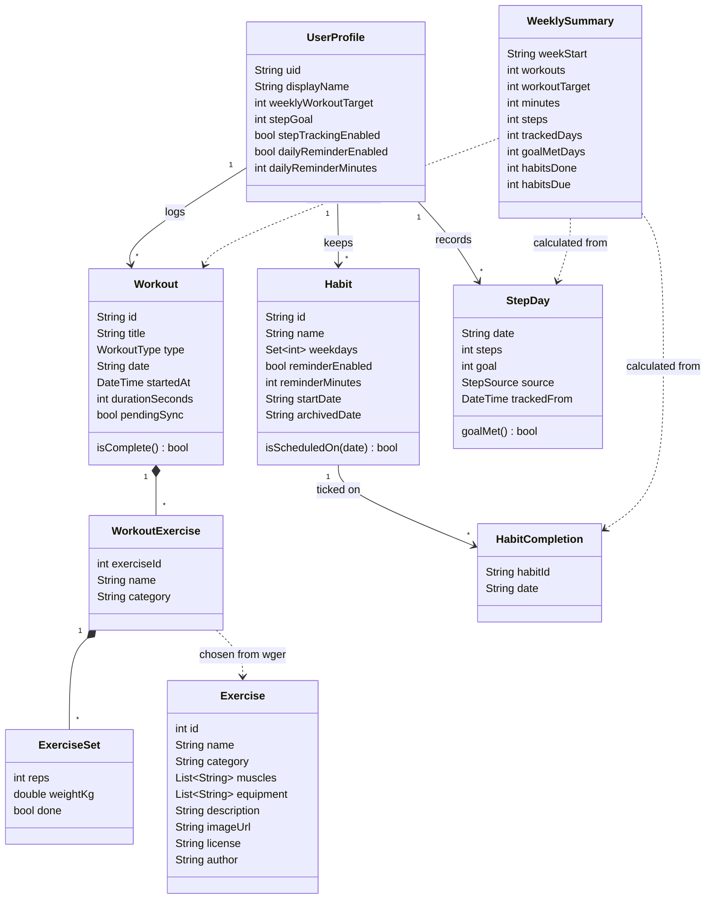
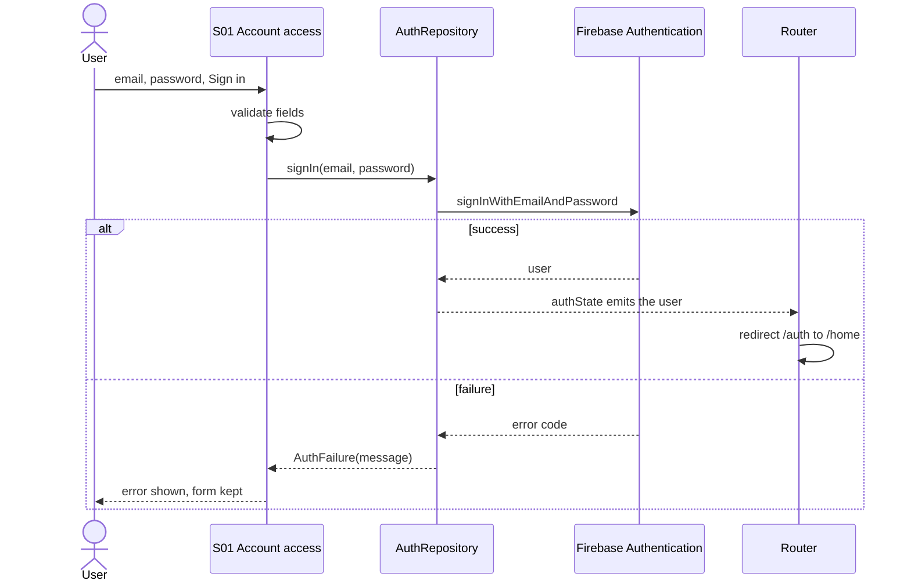
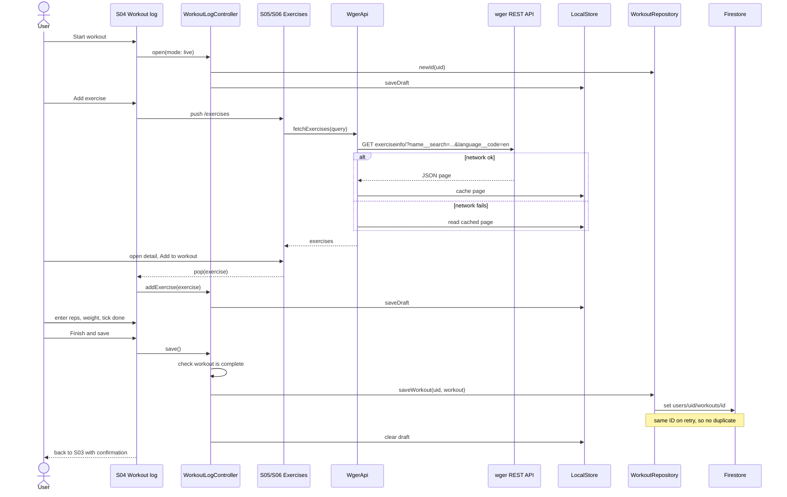
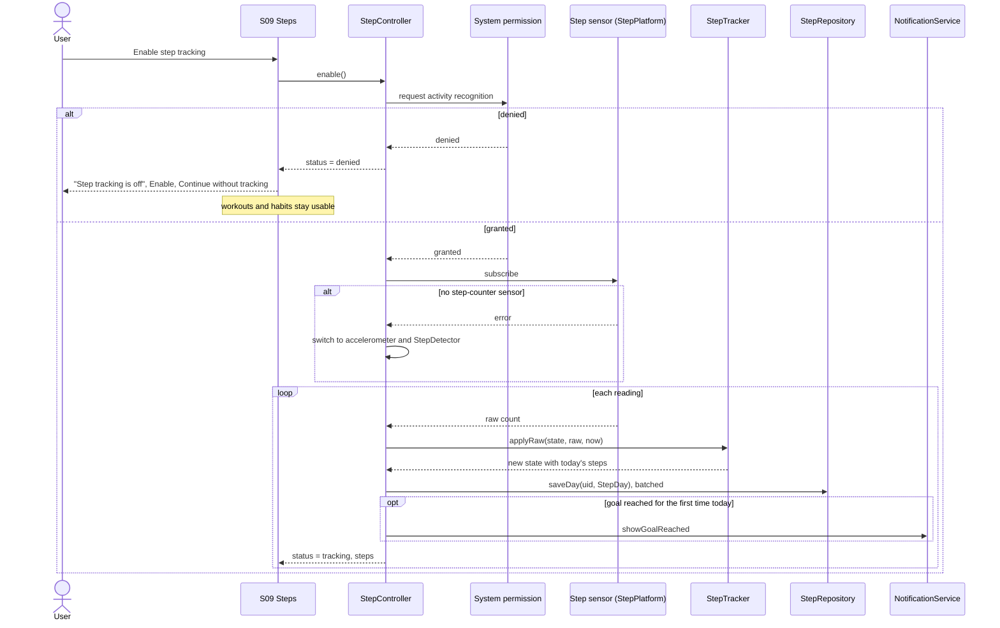
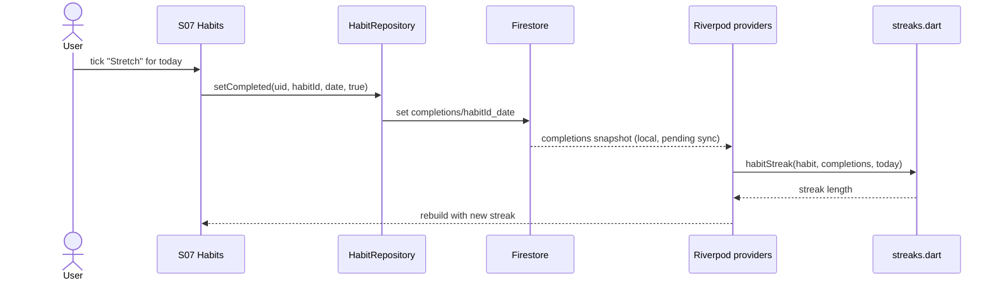
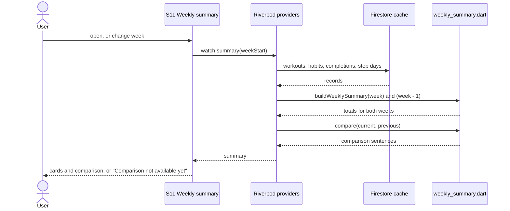

# Diagrams

All diagrams are Mermaid and render on GitHub.

## System diagram

## Navigation flow

## Domain model

## Class diagram

The classes that carry behaviour, by layer.

```mermaid
classDiagram
  direction TB

  class AuthRepository {
    <<interface>>
    authState() Stream~AuthUser~
    signIn(email, password)
    signUp(email, password) AuthUser
    sendPasswordReset(email)
    signOut()
    reauthenticate(password)
    deleteUser()
  }
  class ProfileRepository {
    <<interface>>
    watchProfile(uid) Stream~UserProfile~
    saveProfile(profile)
    deleteAllData(uid)
  }
  class WorkoutRepository {
    <<interface>>
    watchWorkouts(uid) Stream~List~Workout~~
    newId(uid) String
    saveWorkout(uid, workout)
    deleteWorkout(uid, id)
  }
  class HabitRepository {
    <<interface>>
    watchHabits(uid) Stream~List~Habit~~
    watchCompletions(uid) Stream~List~HabitCompletion~~
    saveHabit(uid, habit)
    setCompleted(uid, habitId, date, done)
  }
  class StepRepository {
    <<interface>>
    watchDays(uid) Stream~List~StepDay~~
    saveDay(uid, day)
  }

  class FirebaseAuthRepository
  class FirestoreStore {
    all records under users/uid
  }
  class MemoryBackend {
    in-memory, for demo mode and tests
  }

  AuthRepository <|.. FirebaseAuthRepository
  ProfileRepository <|.. FirestoreStore
  WorkoutRepository <|.. FirestoreStore
  HabitRepository <|.. FirestoreStore
  StepRepository <|.. FirestoreStore
  AuthRepository <|.. MemoryBackend
  ProfileRepository <|.. MemoryBackend
  WorkoutRepository <|.. MemoryBackend
  HabitRepository <|.. MemoryBackend
  StepRepository <|.. MemoryBackend

  class WgerApi {
    fetchExercises(query, offset) ExercisePage
    fetchCategories() List
    fetchEquipment() List
    parseExercise(json) Exercise
    htmlToText(html) String
  }
  class LocalStore {
    loadDraft(uid) WorkoutDraft
    saveDraft(uid, draft)
    loadStepState(uid) StepState
    saveStepState(uid, state)
    cacheGet(key) / cachePut(key, value)
    clearUser(uid)
  }
  class StepPlatform {
    <<interface>>
    checkPermission() PermissionResult
    requestPermission() PermissionResult
    stepCounts() Stream~int~
    accelerometer() Stream~AccelSample~
    openSettings()
  }
  class StepTracker {
    <<pure Dart>>
    applyRaw(state, rawCount, now) StepState
    addSteps(state, count, now) StepState
  }
  class StepDetector {
    <<pure Dart>>
    addSample(x, y, z, time) bool
  }
  class StepController {
    <<Notifier>>
    state StepView
    enable()
    disable()
    refresh()
    flush()
  }
  class NotificationService {
    <<interface>>
    requestPermission() bool
    scheduleDailyReminder(minutes)
    cancelDailyReminder()
    syncHabitReminder(habit)
    cancelHabitReminder(habitId)
    showGoalReached(steps, goal)
    cancelAll()
  }
  class WorkoutLogController {
    <<Notifier>>
    open(mode, workoutId)
    setMode(mode) setType(type)
    addExercise(exercise)
    updateSet(exercise, set, value)
    pause() resume()
    save() String
    discard() delete()
  }
  class CatalogueController {
    <<Notifier>>
    search(query)
    loadMore()
    retry()
  }

  StepController --> StepPlatform
  StepController --> StepTracker
  StepController --> StepDetector
  StepController --> StepRepository
  StepController --> LocalStore
  StepController --> NotificationService
  CatalogueController --> WgerApi
  WgerApi --> LocalStore
  WorkoutLogController --> WorkoutRepository
  WorkoutLogController --> LocalStore
```

## Sequence: sign in

## Sequence: log a workout with a wger exercise

## Sequence: step tracking and a denied permission

## Sequence: tick a habit and update its streak

## Sequence: weekly summary

